# OpenMausBot system map

The [interactive flat map](openmausbot-system.flat.html) and [isometric map](openmausbot-system.iso.html) trace three host-side paths: a chat turn, a scheduled routine, and a paired device request. Click a component for its source and test links, or select a trace to follow one path. The map describes the local host and its optional companion boundary. It is not a map of every cloud service or desktop feature.

<picture>
  <source media="(prefers-color-scheme: dark)" srcset="openmausbot-system.flat.dark.svg">
  
</picture>

[Diagram source](openmausbot-system.bower.json) is the maintained file. The HTML, SVG, PNG and WebP files are generated views. After changing the source, run Bowerbird's `validate --strict` and `render` against that file; check the source and test links before committing refreshed views. The companion boundary is described in [desktop companion mode](../desktop-companion.md), and teammate handoffs in the [runtime contract](../runtime-contract.md).
